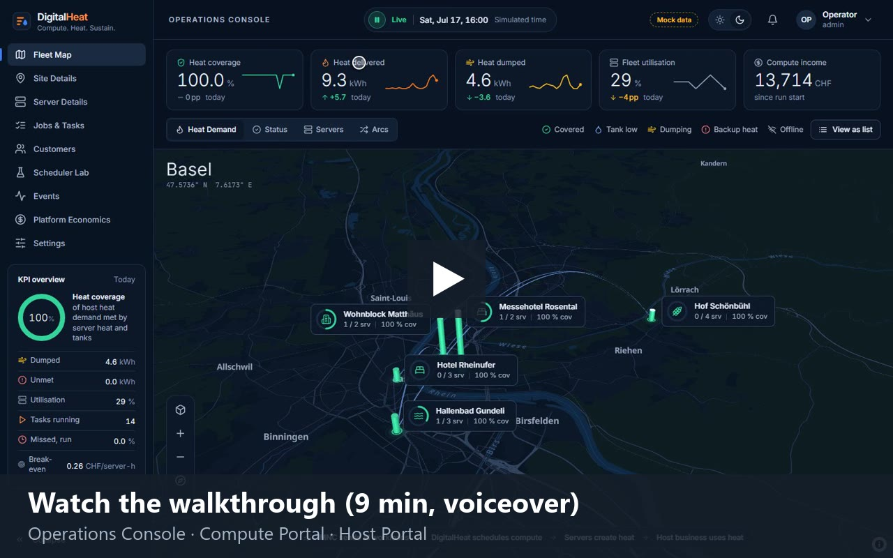

# DigitalHeat frontend

Three role-based experiences on one codebase, wired to the FastAPI backend in this repository (REST and WebSocket):

| Experience | Route | Backend role | Login (password `demo`) |
|---|---|---|---|
| Operations Console | `/ops` | `admin` | `admin` |
| Compute Portal | `/compute` | `customer` | `acme`, `globex` |
| Host Portal | `/host` | `site_owner` | `h1owner` (Hallenbad Gundeli), `hotelgroup` (two hotels) |

The login screen has one-click buttons for the three roles.

[](../docs/media/DigitalHeat_walkthrough.mp4)

Walkthrough video (9 min, voiceover): [`docs/media/DigitalHeat_walkthrough.mp4`](../docs/media/DigitalHeat_walkthrough.mp4).

## Run

```bash
pnpm install
pnpm dev          # live: needs the backend on http://localhost:8000
pnpm dev:mock     # mock: no backend, recorded responses and a replayed simulated day
pnpm lan          # production build served to the local network on port 5173 (live)
```

On the local network, other devices open `http://<this-laptop-ip>:5173`. The frontend server forwards `/api` and the
WebSocket to the backend on this laptop (`DH_BACKEND`, default `http://127.0.0.1:8000`), so nothing has to be configured
on the other devices. Mock mode works only on this laptop (the mock service worker needs `localhost` or HTTPS).

`pnpm portal` starts the portal on port 8080 (`../portal/`): one page with the pitch deck, this dashboard and the walkthrough
video, plus a QR code of its network address. The last slide of the deck shows the same code.

Backend (from the repo root): `DH_MQTT=0 .venv/Scripts/python -m uvicorn api.server:app --port 8000`, with `websockets` installed (see `docs/FRONTEND_GAPS.md` #3).

Configuration (`.env`, see `.env.example`): `VITE_API_BASE`, `VITE_WS_BASE`, `VITE_DEMO_MODE=live|mock`. On a demo laptop press **Shift + D** to change the API address, switch to mock data, reduce motion or see connection diagnostics without rebuilding.

## Checks

```bash
pnpm typecheck    # tsc, strict
pnpm lint         # eslint + terminology guard (scripts/check-terms.mjs)
pnpm test         # vitest: units, reconcile idempotency, role isolation, screen states
pnpm e2e          # playwright smoke tests against a mock build, uses the installed Chrome
pnpm build
```

## Structure

```
design/            Fable design output, tokens, components.md, motion-spec.md, reference.png
scripts/           capture-fixtures.mjs (pnpm capture), fetch-basel-tiles.mjs (pnpm tiles), check-terms.mjs
public/basemap/    Basel OSM vector tiles and label fonts for the offline map
src/api/           client (error envelope, tolerant JSON), schema.ts (generated), types.ts (zod), adapters, queries
src/live/          reconnecting WebSocket, live store, reconcile (REST first, socket on top)
src/mocks/         MSW handlers, mock backend, replay transport, fixtures (captured from the real backend)
src/design-system/ component kit named as in design/components.md
src/features/      ops (map, drawers, screens), compute, host
```

## Data and honesty rules

- Simulated scheduler time everywhere, never the browser clock.
- Every heat or money figure has a unit and a period. Trends only compare like with like (today so far vs the same hours yesterday).
- LIVE vs SIMULATED on every server; no CO2 figures; no "bill savings"; roadmap revenue is labelled "plan, not measured".
- Hosts never see customer or task data; compute buyers never see host operations.

More: `NOTES.md` (decisions), `docs/FRONTEND_GAPS.md` (what the backend lacks), `docs/DEMO_CHECKLIST.md` (stage run-through).

Map data © OpenStreetMap contributors, tiles by OpenFreeMap.
